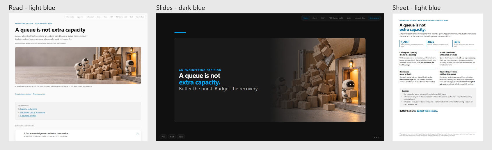
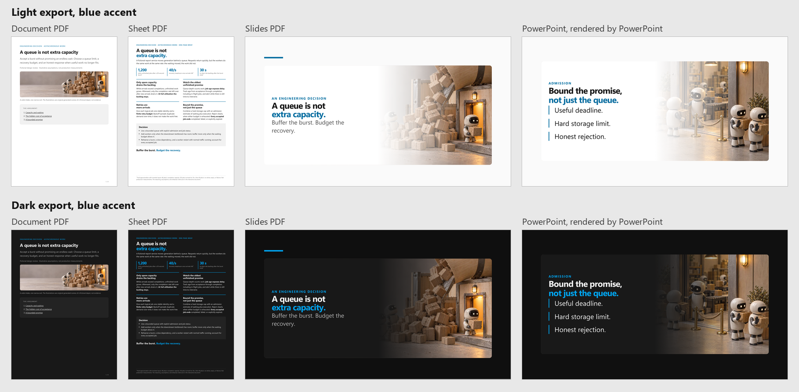

# A queue is not extra capacity

An original fictional engineering talk: **one HTML file for presenting live,
reading the details afterward, and handing out a one-page brief**. Three
chapters, eight cards, seven deeper reveals, an inline theme/accent-aware
diagram, and nine generated illustrations of one robot parcel depot in the
skill's image compositions: hero, split, circle, and panorama. The
presentation follows those same chapters and cards, but uses **short speaker
cues instead of the reading paragraphs**. A designed opening and closing
complete thirteen slides. A companion **sheet** condenses the decision onto
one A4 page.

[](queue-is-not-capacity.standalone.html)

Browser screenshots of one file: reading, presenting, and the sheet view.

## PDF and PowerPoint exports

Each view prints to its own PDF, from the **PDF** button or the skill's
exporter, and the slides also export to PowerPoint. Every export freezes one
palette, so the same file was exported twice, light and dark, both with the
blue accent:

| Export | Light | Dark | From |
|---|---|---|---|
| Document PDF, 9 × A4 | [PDF](exports/light/queue-is-not-capacity.document.pdf) | [PDF](exports/dark/queue-is-not-capacity.document.pdf) | Reading view: full reference, reveals open, page numbers |
| Slides PDF, 13 × 16:9 | [PDF](exports/light/queue-is-not-capacity.slides.pdf) | [PDF](exports/dark/queue-is-not-capacity.slides.pdf) | Slides view: one page per slide, every point shown |
| One-page brief PDF, 1 × A4 | [PDF](exports/light/queue-is-not-capacity.sheet.pdf) | [PDF](exports/dark/queue-is-not-capacity.sheet.pdf) | Sheet view: exactly one page per sheet page |
| PowerPoint, 13 slides | [PPTX](exports/light/queue-is-not-capacity.slides.pptx) | [PPTX](exports/dark/queue-is-not-capacity.slides.pptx) | Slides view: picture design, editable text, speaker notes |

[](exports)

Pages rendered as images. The last column is PowerPoint's own rendering of
the `.pptx`. `test-pptx.js` compared every slide of both files with the
browser: no 32 × 32 slide-pixel area differs, at its 2% limit, including the
slides whose text sits over a photograph's fade. Each `.pptx` is about 7.5 MB
because every slide carries its design, including the illustration, as a
2560-pixel picture; native text needs Segoe UI Variable.

## Illustrations

The nine illustrations are original scenes generated with `gpt-image-2.5`
for this example: robot couriers, parcels, a sorting counter, and one narrow
exit, in a warm miniature style. They are fictional illustrations, not
evidence or measurements; numbers, labels, and the diagram stay in HTML and
SVG. They are stored in [images](images) as 2560 × 1440 JPEGs, linked by the
editable source and embedded by `bundle.js` in the standalone file, which is
therefore about 9 MB.

## Open it

1. Click [the standalone HTML](queue-is-not-capacity.standalone.html).
2. On GitHub, choose **Download raw file**. A GitHub file preview shows source;
   it does not run the presentation. Save the `.html` file, not the GitHub page.
3. Open the downloaded file in a modern browser. No server, account, Node.js,
   network connection, or neighboring assets are needed.
4. Click **Slides** to present. Afterward, send that exact file to listeners:
   they can turn slides off and expand the explanation under each point, or
   click **Sheet** for the one-page brief.

If you cloned the repository, open either the standalone above or the
[editable source](queue-is-not-capacity.html). The source links to
`../../skills/html-docs/assets` and to the illustrations in `images`;
downloading it alone is not enough.

### Controls

- **Reading:** click a card title to expand it; click a reveal for deeper
  reasoning. **Expand all / Collapse all** affect cards, not nested reveals.
- **Presentation:** **Slides** toggles views; `Escape` returns to reading.
  `Right` / `Space` advance points, then slides; `Left` reverses.
  `PageDown` / `PageUp` always skip whole slides.
  `Home` / `End` jump to the ends. **Index** or `O` jumps to a slide.
- **Sheet:** shows the one-page brief as it prints; **Sheet** again or
  `Escape` returns to reading.
- **Full screen:** `F` while presenting. Click a non-control area to advance,
  or swipe horizontally on touch. The screen stays awake while presenting.
- **PDF:** prints the view on screen: the full document, one page per slide
  while presenting, or the sheet. Choose **Save as PDF** in the print dialog.
- **PDF theme:** chooses light (default) or dark printing independently of
  the screen theme. Keep background graphics enabled for dark output.
- **Theme:** **Dark / Light** switches the whole document and diagram.
- **Accent:** cycles blue, red (red-orange), green, yellow. Only one accent
  family is used at a time, alongside black, white, and grayscale; the default
  is blue. Dark mode uses exact logo colors; light mode uses the skill's
  darker counterparts. Legacy `orange` choices resolve to `red`.
- **Animations:** or `A` toggles stepwise cues. Reduced motion shows all points
  without animation. Presentation surfaces contain no reveals or tabs.
- **Read marks:** stored only in the local browser; **Clear marks** resets them.

Theme, accent, and animation choices stay local and are scoped to this
document. You can append `?view=slides`, `?view=sheet`, or
`?view=slides&theme=dark&accent=red#card-premise` to a local HTML URL.
Without JavaScript, the complete article and all reveals remain readable;
interactive presentation controls and the sheet view require JavaScript.

## Exact generation prompt

The original prompts below describe the palette available when the example
was created. Version 1.2.0 updates the runtime and exports to four paired
accent families and eight theme/accent combinations; the talk is unchanged.

> Use html-docs to create an original, polished, fictional engineering talk
> titled “A queue is not extra capacity.” Make it one article with slides mode:
> the live presentation and the detailed follow-up must use the same chapters
> and cards in the same order, with deeper reasoning in reveals. Deliberately
> separate the surfaces: slides support a speaker with one claim and at most
> three short points, never reading paragraphs or interactive controls.
> Author a polished opening and a memorable final-message slide. Use three
> chapters and eight cards, with explanatory prose in the reading bodies.
> Explain completion capacity, recovery
> headroom, queue age, retries, bounded admission, terminal job outcomes, and
> testing the drain path. Use black, white, grayscale and one accent at a time:
> blue by default, with orange/green alternatives through the shared controls.
> Include a simple inline SVG that follows both theme and accent. Use tasteful
> optional point-by-point builds that respect reduced motion. State the
> assumptions explicitly. A worked burst may assume 120 jobs/second arriving
> for 30 seconds, 80 jobs/second completion capacity, and 40 jobs/second arrivals
> afterward; label these as invented inputs, never production metrics.
> Use explanatory prose, no meta narration, no private workplace content,
> no external assets, and no unverifiable benchmark claims. Save the editable
> source as examples/html-docs/queue-is-not-capacity.html, linking to
> ../../skills/html-docs/assets. Include the MIT notice. Build
> queue-is-not-capacity.standalone.html in the same folder so I can present and
> share that one file. Validate source and isolated export in a real browser,
> all six theme/accent combinations and slides, at laptop and projector sizes,
> including keyboard controls, offline and JavaScript-disabled reading.
> Inspect the screenshots and create a representative paired PNG preview.

The companion sheet and PDFs were added later, with this follow-up prompt:

> Add a companion one-page sheet to this example: the decision on one A4 page,
> with the worked-burst figures as key numbers marked as invented inputs, four
> claim blocks, the decision, and a closing line. Use no fact that the article
> does not already state. Enable the Sheet view, rebuild the standalone file,
> validate it, and export the document, slides, and sheet PDFs next to it.

Version 1.6.0 added the illustrations and the PowerPoint exports with this
follow-up prompt:

> Make this example richer in the style of an image-led deck: generate a
> consistent set of original illustrations of one fictional scene and place
> them with the skill's hero, split, circle, and panorama compositions on the
> opening, the cards, and the closing, in both Slides and Read. Keep numbers,
> labels, and the diagram in HTML and SVG. Export light and dark PDFs and
> PowerPoint files with the blue accent into separate folders, and verify
> both PowerPoint files against the browser in desktop PowerPoint.

## Rebuild

Edit the linked source, not the generated `.standalone.html`. From the
repository root, with Node.js installed:

```powershell
node skills\html-docs\assets\sync-head.js examples\html-docs\queue-is-not-capacity.html
node skills\html-docs\assets\bundle.js examples\html-docs\queue-is-not-capacity.html
```

For browser validation and exports, additionally provide Playwright and
Chromium or a compatible installed browser:

```powershell
node skills\html-docs\assets\validate.js examples\html-docs\queue-is-not-capacity.html
$html = "examples\html-docs\queue-is-not-capacity.standalone.html"
foreach ($theme in "light", "dark") {
  $out = "examples\html-docs\exports\$theme"
  node skills\html-docs\assets\export-pdf.js $html --theme $theme --accent blue --out $out
  node skills\html-docs\assets\export-pptx.js $html --theme $theme --accent blue --out $out
  node skills\html-docs\assets\test-pptx.js $html --theme $theme --accent blue
}
```

This rewrites the PDFs and PowerPoint files in `exports`, the same PDFs the
**PDF** button produces in each view. `test-pptx.js` needs desktop PowerPoint
on Windows and writes its renders and difference maps under `validation\pptx`
in the current folder; do not commit them.

Follow [the validation guide](../../skills/html-docs/references/validation.md)
to check the export in isolation and inspect all eight palettes. None of
these authoring tools are required by recipients.
